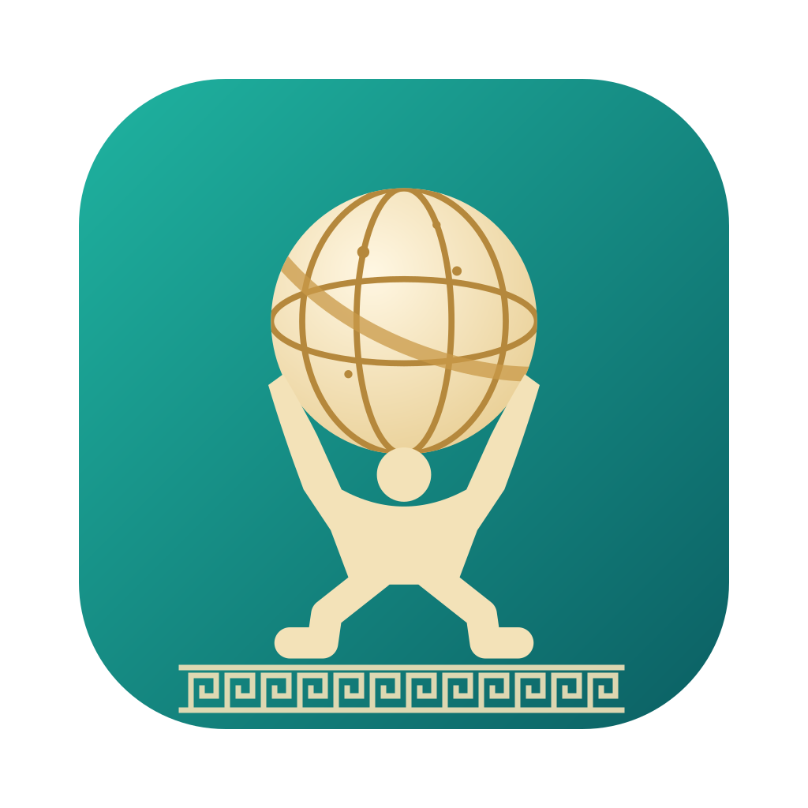

# Atlanta



Atlanta was named Bulgarian Meeting Assistant before.

A meeting workspace for a Mac. It records in-person and online meetings and transcribes
Bulgarian speech. It also makes notes, tasks and decisions that you can edit and review.

## What it does

- **Records** a microphone, an online call (system audio) or both. It also imports audio files.
- **Transcribes** Bulgarian speech on the Mac with Whisper or Parakeet. ElevenLabs Scribe and OpenAI are optional.
- **Separates speakers** and suggests names from voices in earlier meetings. You confirm each name.
- **Makes notes:** summary, decisions, tasks and open questions. Each statement links to its moment in the recording.
- **Collects work in My Work:** tasks from meetings, Gmail, Google Chat and GitHub, in one list.
- **Prepares you** for the next meeting of a project or a series.
- **Searches** all meetings and answers questions from them.

## Install

You need macOS 13 or later on Apple Silicon, Python 3.11 or later, Rust, Node.js and ffmpeg.

```sh
brew install ffmpeg
scripts/install_desktop.sh
open "/Applications/Atlanta.app"
```

The script builds the app and installs it in `/Applications`. It also replaces an older copy.
Run the same script to update the app.

For a run from the source code, see [Install and open the app](docs/install.md).

## First steps

1. Open **Settings** and choose a preset: **Fast**, **Balanced**, **Best quality** or **Maximum privacy**.
2. Choose the AI for the notes in **Settings → AI → Notes & AI**:
   - **Configured API:** a model server on this Mac (for example LM Studio), or a cloud API that is
     compatible with OpenAI (for example Kimi Platform).
   - **OpenAI.**
3. Click **New meeting** and start the recording.
4. After you stop it, the app transcribes the meeting and makes the notes.
5. Name the speakers, then review the notes, tasks and decisions.

## Privacy

- The data stays on this Mac in `~/Library/Application Support/io.github.bhadzhiev.meeting-assistant/`.
- Audio and text go to a cloud service only when you choose that service in Settings.
  The Settings window names each service that gets your data.
- The app keeps saved API keys in macOS Keychain. It never writes them to meeting files.
- The app listens only on `127.0.0.1` and accepts requests only from its own window.
- Ask the participants before you record a meeting.

## Documentation

| Topic | File |
|---|---|
| Install, build and the desktop app | [docs/install.md](docs/install.md) |
| Navigation, recording and import | [docs/recording.md](docs/recording.md) |
| Transcription, AI notes, analytics, search and people | [docs/transcription-and-notes.md](docs/transcription-and-notes.md) |
| Projects, conversations and the workspace | [docs/workspace.md](docs/workspace.md) |
| My Work, Gmail and Google Chat | [docs/my-work-and-sources.md](docs/my-work-and-sources.md) |
| GitHub | [docs/github.md](docs/github.md) |
| Automatic titles and Google Calendar | [docs/calendar-and-titles.md](docs/calendar-and-titles.md) |
| Archive, durability and recovery | [docs/backup-and-recovery.md](docs/backup-and-recovery.md) |
| Development, the CLI and tests | [docs/development.md](docs/development.md) |

## Development

```sh
python3 -m venv .venv
.venv/bin/python -m pip install -r requirements.txt
.venv/bin/python -m unittest
for f in tests/web_*regressions.cjs; do node "$f"; done
```

Read [CONTRIBUTING.md](CONTRIBUTING.md) before you open a pull request.
